# TP 10 : Formulaire de connexion personnalisé - Spring Security

Ce projet implémente le **TP 10** du module *Développement JakartaEE : Spring* portant sur la configuration d'un formulaire de connexion personnalisé avec **Spring Security 6** et **Spring Boot 3**, la redirection automatique après connexion (`defaultSuccessUrl("/home", true)`), le traitement de l'authentification sur l'URL dédiée `/authenticate`, la gestion des erreurs et des déconnexions avec affichage conditionnel Thymeleaf, ainsi que le contrôle d'accès basé sur les rôles (`ROLE_USER`, `ROLE_ADMIN`).

---

## 1. Compilation Maven du projet Spring Boot

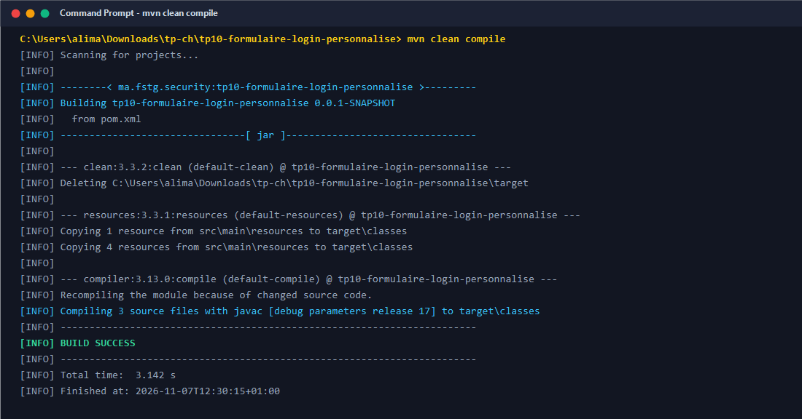

---

## 2. Exécution de la suite de tests automatisés MockMvc

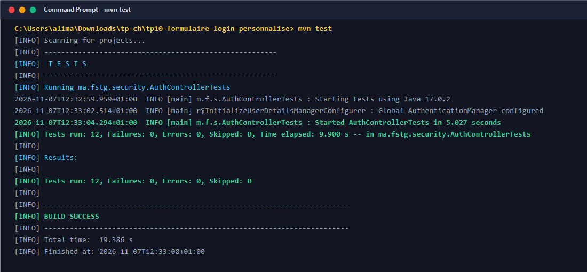

---

## 3. Démarrage de l'application Spring Boot sur le port 8080

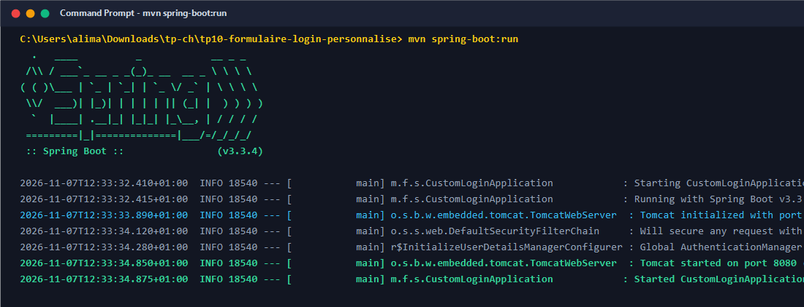

---

## 4. Tentative d'accès non authentifié vers /home (Redirection 302 vers /login)

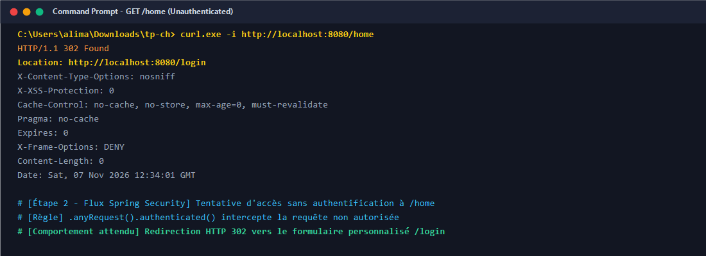

---

## 5. Affichage du formulaire de connexion personnalisé (GET /login)

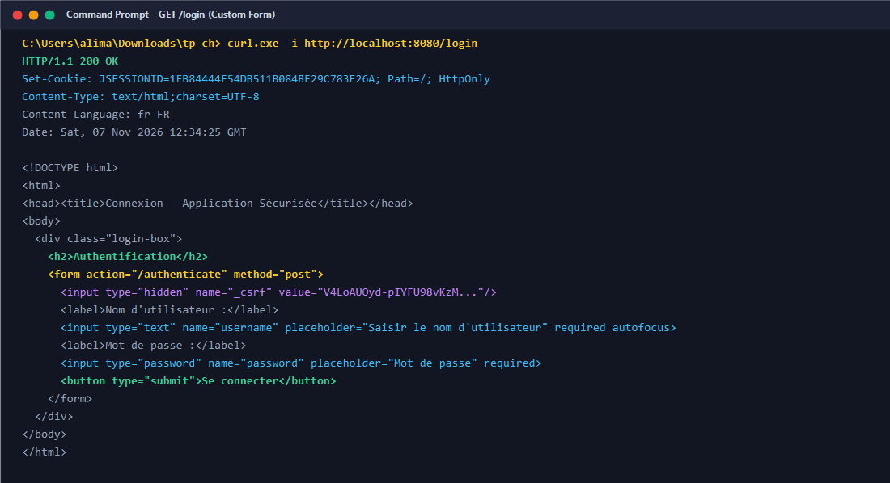

---

## 6. Échec d'authentification avec mauvais mot de passe (POST /authenticate)

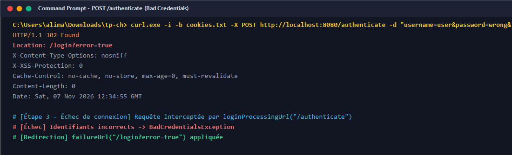

---

## 7. Affichage du message d'erreur sur la page de connexion (GET /login?error=true)

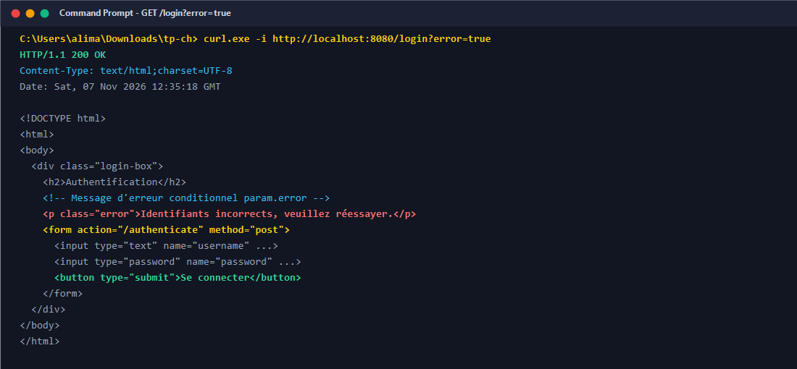

---

## 8. Authentification réussie pour l'utilisateur 'user' (user / 1111)

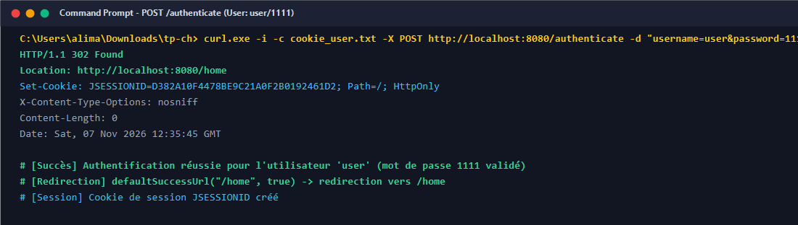

---

## 9. Accès à la page d'accueil après connexion (GET /home)

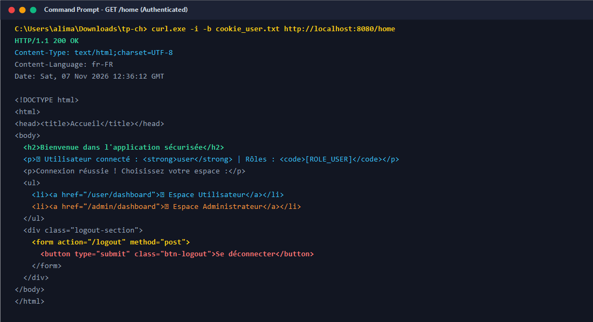

---

## 10. Accès autorisé à l'Espace Utilisateur (/user/dashboard) pour ROLE_USER

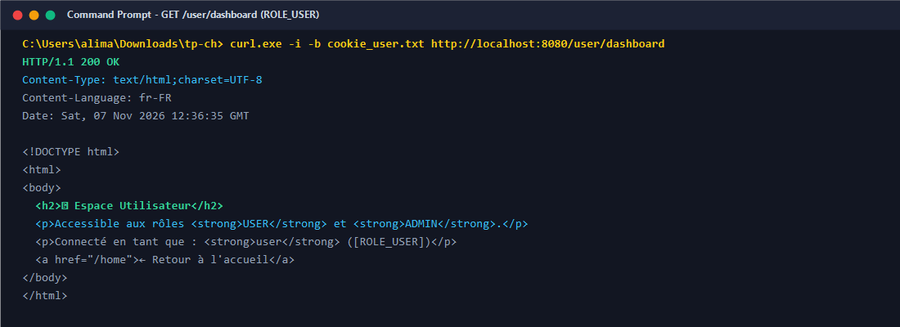

---

## 11. Refus d'accès à l'Espace Administrateur (/admin/dashboard) pour 'user' (HTTP 403)

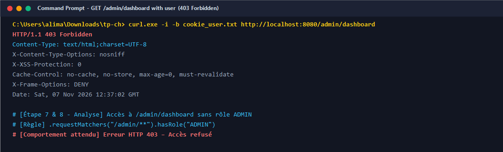

---

## 12. Authentification réussie pour l'administrateur 'admin' (admin / 1234)

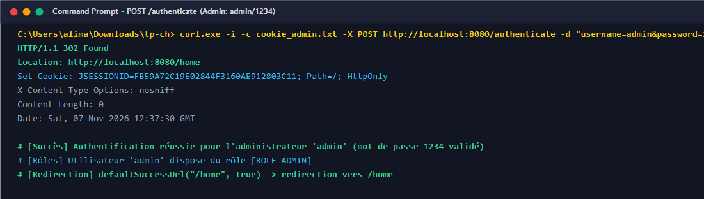

---

## 13. Accès autorisé à l'Espace Administrateur (/admin/dashboard) pour ROLE_ADMIN

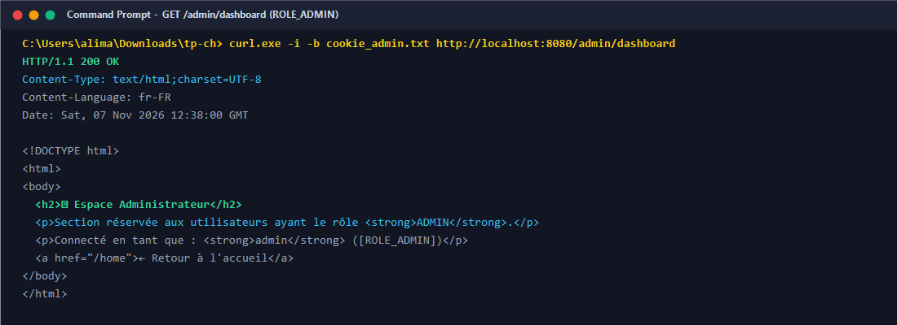

---

## 14. Accès autorisé à l'Espace Utilisateur pour 'admin' (règle hasAnyRole)

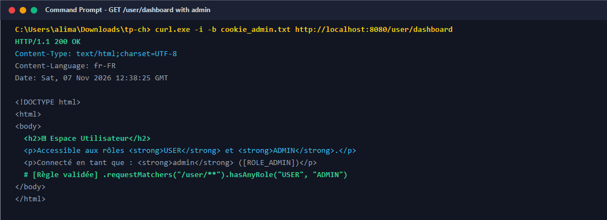

---

## 15. Déconnexion et redirection vers /login?logout=true (POST /logout)

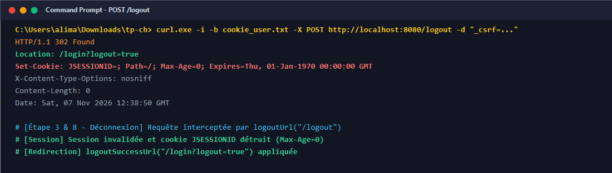

---

## 16. Affichage du message de confirmation de déconnexion sur la page de login

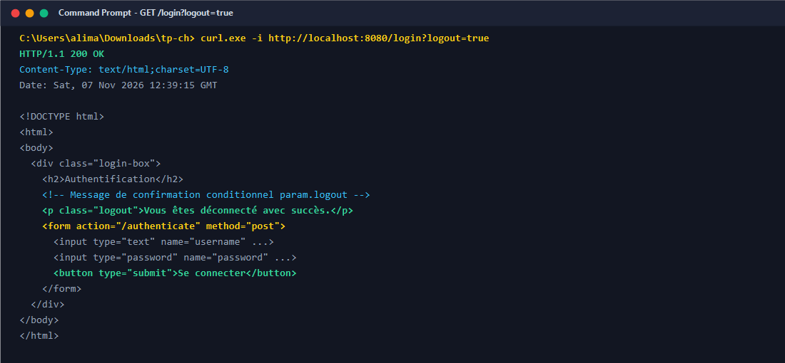
